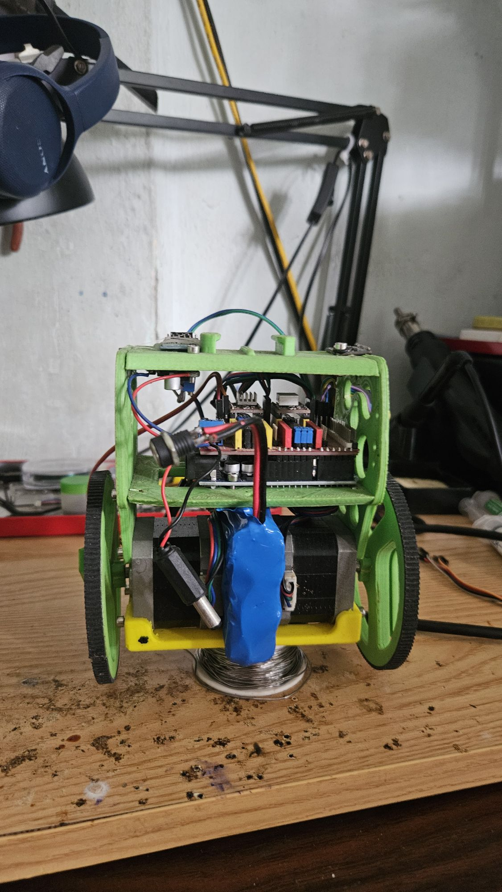
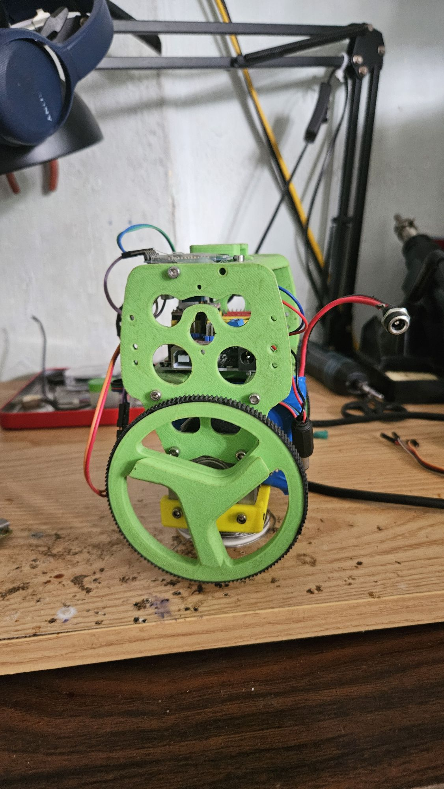
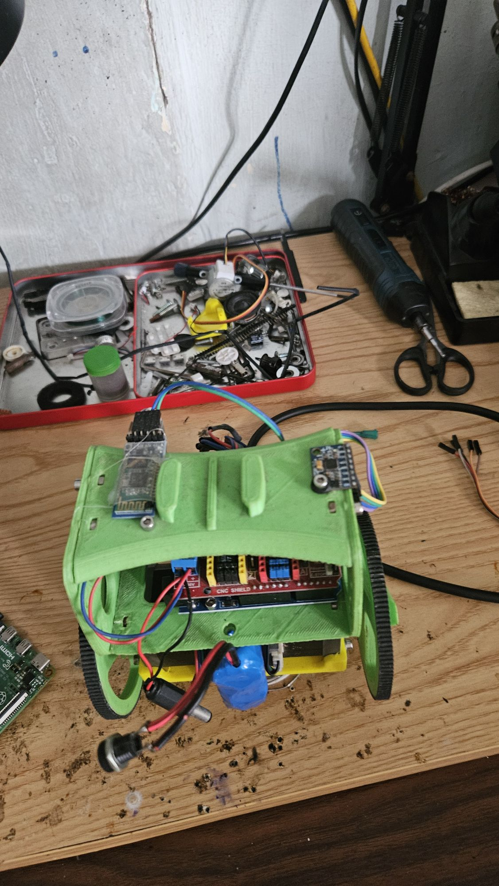
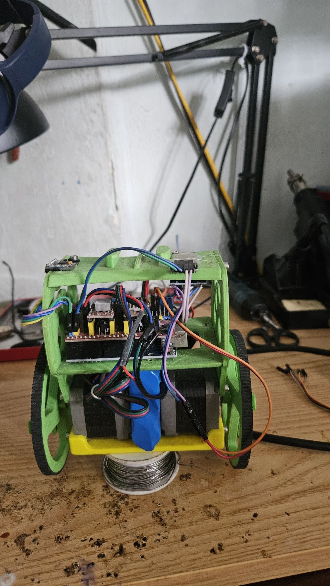

# balance_bot

A self-balancing two-wheeled robot: Arduino Uno firmware plus a Python console that tunes
it live over Bluetooth, so changing a gain never means plugging in a USB cable.

 

Measured on hardware, 2026-10-25, standing still with the position loop closed:

| | |
|---|---|
| `angle` standard deviation | **0.018°** |
| Position held over 14 s | **±3 steps (±0.5 mm)** |
| Recovery from a knock | displaced 2.57 cm, returned to **0.00 cm** |
| Position drift | **0.02 cm in 25 s** (1 cm/s before the gyro bias was fixed) |

It balances straight out of reset with no PC attached — the compile-time defaults are the
measured-good set, and they are mirrored in `configs/balance_good.txt`.

## Hardware

| Component | Detail |
|---|---|
| MCU | Arduino Uno (ATmega328P @ 16 MHz) |
| IMU | MPU-6050, I²C, DLPF 10 Hz, gyro ±250°/s |
| Motors | 2 × NEMA17 stepper, 1/8 microstep, A4988 on a CNC shield |
| Wheels | 90 mm, direct drive, 1600 steps/rev → **1 step = 0.177 mm** |
| Wheel track | 140.6 mm (measured, not guessed) |
| Bluetooth | HC-05 on hardware Serial, 115200 baud |
| Battery | 3 × 18650 in series (11.1 V) |

Wiring, power and A4988 Vref are in [`HUONG_DAN.md`](HUONG_DAN.md) (Vietnamese). Its PID
section is obsolete — ignore it and use [`CLAUDE.md`](CLAUDE.md).

 

Left: the HC-05 and the MPU-6050 sit on the upper deck, with the CNC shield and its two
A4988 drivers directly underneath. Right: the battery hangs between the two motors, just
above the yellow base plate.

That battery position is deliberate and was nearly undone. The obvious instinct is to raise
the centre of mass to slow the robot's fall, and moving the pack to the top deck was
computed and **rejected**: for a rigid body the unstable pole is
`p = sqrt(m*g*L / (I_cg + m*L^2))`, which is not monotonic in `L` but peaks at `L = k`, the
radius of gyration. Raising the battery moves `L` to 50 mm and `k` to 53 mm, landing almost
exactly on the worst case, and `p` gets *worse*, 9.0 to 9.6 rad/s. The point-mass formula
`sqrt(g/L)` that suggests otherwise overstates `p` by 2.5x here and does not apply.

The low mass is also what makes the detent problem below unavoidable, so the two are the
same design decision seen from opposite sides.

## Quick start

```powershell
# flash
arduino-cli compile --fqbn arduino:avr:uno .
arduino-cli upload -p COM7 --fqbn arduino:avr:uno .

# connect (HC-05 must already be paired in Windows Bluetooth settings)
pip install rich prompt_toolkit
python robot_control.py
```

Hold the robot still for the first four seconds after power-up: that is the gyro
calibration window, and getting it wrong is the single most damaging mistake you can make
(see below).

Then stand the robot up and let go immediately. Do not hold it upright — the output stage
is a pure integrator and holding it winds the wheels up to full speed.

## Three things worth knowing before you copy this

**A stepper commanded at constant speed exerts no force.** The obvious architecture — PID
output *is* the wheel speed — cannot balance a stepper-driven robot, because a wheel
rolling at a steady velocity produces no restoring force. The PID output has to be
*integrated* into a speed, so that it commands acceleration. Both forms are compiled in and
selected at runtime with `arch 0|1`; `arch 1` is the one that works, and the two need
completely different gains. This is the single largest divergence from
[B-ROBOT EVO2](https://github.com/jjrobots/B-ROBOT_EVO2), whose Timer1 step generator this
project borrows.

**Leaning does not drive this robot.** With the centre of mass only 59 mm above the ground,
a 1° lean produces about 10 mN·m about the contact patch — less than a NEMA17's detent
torque. Measured: `DRIVE 1.0` moved the robot 0.10 cm in three seconds; it took 2.5° before
anything happened at all, and a 4.45° lean with the wheels stationary just stayed there. So
drive commands set a wheel *velocity* setpoint and let the balance loop work out the lean
for itself.

**Gyro bias is the dominant failure mode.** A robot that had been balancing to 0.018°
crept a metre over 100 seconds and then charged backwards at 3000 step/s and fell. The
cause was a `gyroBias` measured 20°/s off, because the robot was touched during the
four-second calibration. A P-only position loop leaves a steady-state error against that
sort of constant disturbance, and a metre of error demanded more speed than the robot could
survive. **Check that `gyro` averages within ±0.2°/s while the robot stands still before
you trust any other measurement.**

## Architecture

Three nested loops, each slower than the one it wraps:

```
position (Kp_pos, on cumulative step count)
  └─ velocity (10 Hz, Kp_vel / Ki_vel)       → target angle
       └─ angle (100 Hz, Kp / Ki / Kd)       → acceleration
            └─ integrate → step rate → Timer1 ISR, one compare channel per motor
```

The angle loop's D term uses the raw gyro rate rather than differentiating the angle error,
which is far quieter. Step pulses come from a Timer1 ISR at 250 kHz, so the main loop never
blocks.

## Everything is tunable over Bluetooth

Parameters live in one `PROGMEM` table in the firmware. Adding a tunable is **one line**,
and it brings with it the BT command, range clamping, EEPROM save/load, `reset` to default,
and a line in the `p` dump. There is no list on the Python side to keep in sync.

```c
//  name       variable            type      min       max      default
  { "KP",      &Kp_angle,          PT_F32,    0.0f,   500.0f,    45.0f  },
```

Telemetry works the same way: a second table decides which variables stream, `log_mask`
picks the rows at runtime, and the firmware announces the current set with a `#COLS` line
that the PC treats as the sole source of truth.

```
cfg balance_good     # send a tuned parameter set
kp 45                # set a gain
kp                   # read it back
log gyro             # toggle a telemetry column
save                 # persist to EEPROM (robot must be lying down)
```

Each session writes two files to `logs/`: a readable transcript, and every telemetry sample
at 100 Hz as TSV. `analyze_log.py` gives per-column statistics and an amplitude spectrum —
that spectrum is what finally identified a 0.6 Hz oscillation that half-second transcript
logging had been aliasing into an apparent high-frequency limit cycle.

## Phone control

The firmware also answers the bare single characters that Arduino-BT-style phone apps send
(`F B L R S`, diagonals `G I H J`, and `0`-`9` for the speed slider) while still accepting
multi-character commands, which collide with them: `B` is both *backward* and the first
letter of `BIAS`. It separates the two by timing and repetition rather than by content.
`test_bt_parser.py` simulates that state machine on the host so the logic can be checked
without an upload.

## Repository layout

```
robot_balance.ino       Firmware
robot_control.py        PC console: Bluetooth, live telemetry, command input
robot_auto.py           Keeps the link up and re-sends the config after every reboot
analyze_log.py          Statistics and amplitude spectrum for logs/*_raw.tsv
test_bt_parser.py       Host-side simulation of the BT command state machine
check_defaults.py       Checks PARAMS table defaults against variable initialisers
configs/                Tuned parameter sets, one command per line
docs/                   Photographs of the build
logs/                   Session logs; the measurements in CLAUDE.md cite these directly
test_motor/ test_imu/   Standalone test sketches
hc05_config/            One-shot sketch to change the HC-05 baud rate
HUONG_DAN.md            Wiring, power and Vref guide (Vietnamese)
CLAUDE.md               The full measurement record and the reasoning behind every value
```

## Where the real documentation is

[`CLAUDE.md`](CLAUDE.md) is the substantial document. It records what was measured, what the
number was, and why each non-obvious decision was made — including several conclusions that
turned out to be wrong and how they were caught. If you are going to build on this, read
that file rather than the code comments.
